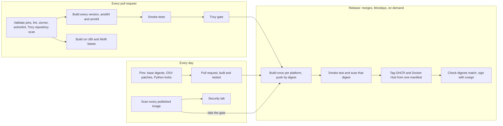

<!-- Generated from HEADER.md and versions.yml by `just docs`. Edit those, not this file. -->
<!--
  Keep the title and badges OUTSIDE the centred <div>: some markdown renderers do not
  parse markdown inside an HTML block, so a # heading or [![badge]] in the div renders as
  literal text. Only the logo (HTML) goes in the div.
-->
<div align="center">
  <a href="https://libredevops.org">
    <picture>
      <source media="(prefers-color-scheme: dark)" srcset="https://libredevops.org/assets/libre-devops-white.png">
      
    </picture>
  </a>
</div>

# Libre DevOps Container Images

Thin, hardened, version-pinned images for CI jobs and tooling: built from pinned inputs on
Docker Hardened Images, scanned before and after publishing, signed, and published to GHCR and
Docker Hub from the same digest.

[](https://github.com/libre-devops/container-images/actions/workflows/build.yml)
[](https://github.com/libre-devops/container-images/actions/workflows/release.yml)
[](https://github.com/libre-devops/container-images/actions/workflows/scan.yml)
[](./LICENSE)
[](https://github.com/orgs/libre-devops/packages?repo_name=container-images)
[](https://hub.docker.com/u/libredevops)

---

## Contents

- [Overview](#overview)
- [Quick start](#quick-start)
- [Images](#images)
- [Choosing an image](#choosing-an-image)
- [Tags, versions and support](#tags-versions-and-support)
- [Usage](#usage)
- [Configuration reference](#configuration-reference)
- [Adding an organisation's CA bundle](#adding-an-organisations-ca-bundle)
- [Pinning by digest or date tag](#pinning-by-digest-or-date-tag)
- [Security and supply chain](#security-and-supply-chain)
- [Changing the base image](#changing-the-base-image)
- [Troubleshooting](#troubleshooting)
- [Developing](#developing)
- [Contributing](#contributing)
- [Licence](#licence)

## Overview

Five images, each a thin layer of pinned tools on a hardened base:

- **`python`**: CPython and uv, with one tag for every supported CPython from 3.12 upwards.
- **`azure-cli`**: the Azure CLI in its own virtual environment, and
  [`ldo-cli`](https://github.com/libre-devops/ldo-cli). The current release, plus 2.72.0 as a
  long-lived line.
- **`terraform`**: tenv with a default Terraform, TFLint, terraform-docs and Conftest. A
  repository's `.terraform-version` wins over the default.
- **`powershell`**: PowerShell LTS with PSScriptAnalyzer, Pester, Az and
  [LibreDevOpsHelpers](https://github.com/libre-devops/powershell-helpers).
- **`toolbox`**: every tool above in one image, assembled from the same build stages.

What every image guarantees:

| Property | How |
| --- | --- |
| Hardened base | [Docker Hardened Images](https://hub.docker.com/hardened-images/catalog) on Debian 13, pinned by digest |
| No known fixable vulnerabilities at publication | Scanned on every pull request, at release (the exact digest pushed) and daily after; fixes are applied at the source, not excused |
| Every input pinned | Bases by digest; downloads by version and SHA-256 per platform; Go modules through the Go checksum database; Python packages by hash |
| Reproducible references | Date tags are never overwritten; every tag has the same digest in GHCR and Docker Hub |
| Verifiable | cosign keyless signature, SBOM and SLSA provenance on every published digest |
| Non-root | Runs as `app` (uid 10001) in `/work`; works rootless under Podman, and as an arbitrary uid in group 0 |
| Multi-platform | linux/amd64 and linux/arm64, each built natively |
| Portable | The same build runs on RHEL (UBI) and Wolfi bases, proven on every pull request |
| Current | Rebuilt every Monday, on every merge, and whenever a published image can be fixed by a rebuild |

## Quick start

```sh
# Pull from either registry; the digest is the same.
docker pull ghcr.io/libre-devops/terraform:1
docker pull docker.io/libredevops/terraform:1

# Run against the current directory.
docker run --rm -v "$PWD:/work" ghcr.io/libre-devops/terraform:1 terraform fmt -check

# Verify the signature before you trust it.
cosign verify ghcr.io/libre-devops/terraform:1 \
  --certificate-identity https://github.com/libre-devops/container-images/.github/workflows/release.yml@refs/heads/main \
  --certificate-oidc-issuer https://token.actions.githubusercontent.com
```

## Images

| Image | Tags | Base | Contents | Pull |
| --- | --- | --- | --- | --- |
| `python` | `3.12`<br>`3.12-YYYYMMDD` | `dhi.io/python:3.12-debian13-dev` | CPython 3.12, uv 0.13.7 | `ghcr.io/libre-devops/python:3.12`<br>`docker.io/libredevops/python:3.12` |
| `python` | `3.13`<br>`3.13-YYYYMMDD` | `dhi.io/python:3.13-debian13-dev` | CPython 3.13, uv 0.13.7 | `ghcr.io/libre-devops/python:3.13`<br>`docker.io/libredevops/python:3.13` |
| `python` | `3.14`<br>`3.14-YYYYMMDD` | `dhi.io/python:3.14-debian13-dev` | CPython 3.14, uv 0.13.7 | `ghcr.io/libre-devops/python:3.14`<br>`docker.io/libredevops/python:3.14` |
| `python` | `3.15` `3` `latest`<br>`3.15-YYYYMMDD` | `dhi.io/python:3.15-debian13-dev` | CPython 3.15, uv 0.13.7 | `ghcr.io/libre-devops/python:3.15`<br>`docker.io/libredevops/python:3.15` |
| `azure-cli` | `2.92.0` `latest`<br>`2.92.0-py3.12-YYYYMMDD` | `dhi.io/python:3.12-debian13-dev` | Azure CLI 2.92.0 on Python 3.12, ldo-cli 0.8.1 | `ghcr.io/libre-devops/azure-cli:2.92.0`<br>`docker.io/libredevops/azure-cli:2.92.0` |
| `azure-cli` | `2.72.0`<br>`2.72.0-py3.12-YYYYMMDD` | `dhi.io/python:3.12-debian13-dev` | Azure CLI 2.72.0 on Python 3.12, ldo-cli 0.8.1 | `ghcr.io/libre-devops/azure-cli:2.72.0`<br>`docker.io/libredevops/azure-cli:2.72.0` |
| `terraform` | `1.17.1` `1.17` `1` `latest`<br>`1.17.1-YYYYMMDD` | `dhi.io/debian-base:trixie-debian13-dev` | Terraform 1.17.1 by default (tenv 4.15.1; a repository's .terraform-version wins), TFLint 0.65.0, terraform-docs 0.24.0, Conftest 0.71.1 | `ghcr.io/libre-devops/terraform:1.17.1`<br>`docker.io/libredevops/terraform:1.17.1` |
| `powershell` | `7.6.9` `7.6` `7` `lts` `latest`<br>`7.6.9-YYYYMMDD` | `dhi.io/debian-base:trixie-debian13-dev` | PowerShell 7.6.9, Az 16.5.0, Pester 6.2.0, PSScriptAnalyzer 1.25.0, LibreDevOpsHelpers 3.0.1 | `ghcr.io/libre-devops/powershell:7.6.9`<br>`docker.io/libredevops/powershell:7.6.9` |
| `toolbox` | `1` `latest`<br>`1-YYYYMMDD` | `dhi.io/python:3.12-debian13-dev` | Python 3.12 and uv 0.13.7, Azure CLI 2.92.0, ldo-cli 0.8.1, Terraform 1.17.1 by default (tenv 4.15.1), TFLint 0.65.0, terraform-docs 0.24.0, Conftest 0.71.1, PowerShell 7.6.9 with Az 16.5.0, Pester 6.2.0, PSScriptAnalyzer 1.25.0 and LibreDevOpsHelpers 3.0.1 | `ghcr.io/libre-devops/toolbox:1`<br>`docker.io/libredevops/toolbox:1` |

Every image also has bash, git, curl, ca-certificates, ShellCheck 0.11.0, shfmt 3.14.1, jq 1.8.2, runs as `app` (uid 10001) in `/work`, and is a multi-platform image for linux/amd64 and linux/arm64. The Go tools are built from source with Go 1.27.3.

## Choosing an image

| If you need | Use | Why |
| --- | --- | --- |
| One tool family in a CI job | `python`, `azure-cli`, `terraform` or `powershell` | Smaller pulls, smaller attack surface, fewer reasons to rebuild |
| Several tool families in one job, or an interactive shell | `toolbox` | Everything together; the largest image (the Az PowerShell modules and the Azure CLI dominate its size) |
| A specific CPython | `python:<major.minor>` | One tag per supported CPython |
| The Azure CLI behind TLS inspection that rejects Python 3.13's stricter checks | `azure-cli:2.72.0` | Long-lived line on Python 3.12 |
| Your organisation's CA, mirrors or internal tools | A thin layer `FROM` a pinned digest of one of these | See [Adding an organisation's CA bundle](#adding-an-organisations-ca-bundle) |

## Tags, versions and support

| Tag | Example | Moves? |
| --- | --- | --- |
| Version and build date | `python:3.12-20261107`, `azure-cli:2.72.0-py3.12-20261107` | Never. A second build on the same day gets `.2`, `.3` and so on |
| Version | `python:3.12`, `azure-cli:2.72.0` | Yes, to the newest build of that version |
| Major or major.minor | `terraform:1`, `terraform:1.17`, `python:3`, `toolbox:1` | Yes |
| Alias | `powershell:lts` | Yes |
| `latest` | `python:latest` | Yes, to the newest supported version |

Every release records its digests in this README and in
[`releases.json`](./releases.json).

**What is built.** Every version listed in [`versions.yml`](./versions.yml):

| Image | Versions |
| --- | --- |
| `python` | Every CPython release from 3.12 upwards that upstream still supports |
| `azure-cli` | The current release, and 2.72.0 as a long-lived line for networks whose TLS inspection fails the stricter certificate checks in Python 3.13 and later |
| `terraform` | The current Terraform 1.x as the default; any other version through `.terraform-version` |
| `powershell` | The current PowerShell LTS |
| `toolbox` | The latest version of each of the above, with the Azure CLI's Python |

**Support.** A version is supported while it is listed in `versions.yml`: its moving tags are
rebuilt weekly and whenever a fix is available. When a version leaves `versions.yml` (for
example when upstream support ends), its tags stop moving and receive no further fixes, but
nothing published is ever deleted or re-tagged, so pinned references keep working.

## Usage

The examples use moving tags for brevity. For anything you need to reproduce, pin a date tag
or a digest (see [Pinning by digest or date tag](#pinning-by-digest-or-date-tag)).

### GitHub Actions

As a container job. The runner mounts the workspace and `HOME` as uid 1001, so run the job as
that uid in group 0; the images' home, work and tool directories are writable by group 0.

```yaml
jobs:
  plan:
    runs-on: ubuntu-24.04
    container:
      image: ghcr.io/libre-devops/terraform:1
      options: --user 1001:0
    steps:
      - uses: actions/checkout@v7
      - run: terraform init -backend=false && terraform validate
      - run: tflint --init && tflint
```

### GitLab CI

```yaml
test:
  image: ghcr.io/libre-devops/python:3.13
  script:
    - uv sync --locked
    - uv run pytest
```

### Azure DevOps

The Azure Pipelines agent adds its own user inside a container job, which needs root, so start
the container as root. `useradd` and `groupadd` are in every image for this.

```yaml
resources:
  containers:
    - container: azure
      image: ghcr.io/libre-devops/azure-cli:2.92.0
      options: --user 0:0

jobs:
  - job: deploy
    container: azure
    steps:
      - script: az version
```

Or run a single command with `docker run`, as your own uid so that files written to the
workspace stay yours:

```yaml
steps:
  - script: >-
      docker run --rm --user "$(id -u):0" -v "$(Build.SourcesDirectory):/work"
      ghcr.io/libre-devops/powershell:lts pwsh -File ./build.ps1
```

### Rootless Podman

`--userns=keep-id` maps your user to the image's uid 10001, so files in the mounted directory
are owned by you on both sides:

```sh
podman run --rm -it --userns=keep-id:uid=10001,gid=10001 \
  -v "$PWD:/work:Z" ghcr.io/libre-devops/terraform:1 terraform fmt -check
```

### Kubernetes and OpenShift

The images run as a non-root numeric uid, so `runAsNonRoot: true` is satisfied as is. An
arbitrary uid (OpenShift's default) works too, because the writable directories belong to
group 0:

```yaml
securityContext:
  runAsNonRoot: true
  runAsUser: 10001
  runAsGroup: 10001
  allowPrivilegeEscalation: false
  capabilities:
    drop: ["ALL"]
```

## Configuration reference

### User and paths

| Path | Purpose | Writable by |
| --- | --- | --- |
| `/home/app` | `HOME` for every user the image runs as | `app`, and any uid in group 0 |
| `/work` | Working directory; mount your project here | `app`, and any uid in group 0 |
| `/opt/az` | The Azure CLI's virtual environment (`azure-cli`, `toolbox`) | root |
| `/opt/ldo-cli` | ldo-cli's virtual environment (`azure-cli`, `toolbox`) | root |
| `/opt/microsoft/powershell/7` | PowerShell (`powershell`, `toolbox`) | root |
| `/usr/local/share/powershell/Modules` | Pinned PowerShell modules, for all users | root |
| `/home/app/.tenv` | tenv's Terraform installs (`TENV_ROOT`) | `app`, and any uid in group 0 |

### Environment

Set by the images; override any of them with `-e` or your CI system's environment settings.

| Variable | Value | Image | Effect |
| --- | --- | --- | --- |
| `HOME` | `/home/app` | all | Consistent home for any uid |
| `PYTHONUNBUFFERED` | `1` | `python`, `azure-cli`, `toolbox` | Unbuffered output in CI logs |
| `AZURE_CORE_COLLECT_TELEMETRY` | `no` | `azure-cli`, `toolbox` | No Azure CLI telemetry |
| `TENV_ROOT` | `/home/app/.tenv` | `terraform`, `toolbox` | Where tenv keeps Terraform versions |
| `TENV_AUTO_INSTALL` | `true` | `terraform`, `toolbox` | A `.terraform-version` installs on demand; set `false` offline |
| `CHECKPOINT_DISABLE` | `1` | `terraform`, `toolbox` | No HashiCorp update checks |
| `POWERSHELL_TELEMETRY_OPTOUT` | `1` | `powershell`, `toolbox` | No PowerShell telemetry |
| `POWERSHELL_UPDATECHECK` | `Off` | `powershell`, `toolbox` | No update notices |
| `DOTNET_CLI_TELEMETRY_OPTOUT`, `DOTNET_NOLOGO` | `1` | `powershell`, `toolbox` | No .NET telemetry or banners |

git trusts every directory (`safe.directory = *` in the system configuration), because CI
systems mount workspaces owned by other uids.

## Adding an organisation's CA bundle

Networks with TLS inspection need their root CA in the image. Build a thin layer `FROM` a
pinned digest of these images, add the certificate, and switch back to the app user:

```Dockerfile
FROM ghcr.io/libre-devops/azure-cli:2.92.0@sha256:<digest>
USER root
COPY organisation-root-ca.crt /usr/local/share/ca-certificates/organisation-root-ca.crt
RUN update-ca-certificates
USER 10001:10001
```

That covers curl, git, Terraform and the Go tools, PowerShell and .NET, and Python's `ssl`
module. Some tools carry their own bundle and need pointing at the system one:

| Tool | Setting |
| --- | --- |
| Azure CLI, Python `requests` | `REQUESTS_CA_BUNDLE=/etc/ssl/certs/ca-certificates.crt` |
| pip | `PIP_CERT=/etc/ssl/certs/ca-certificates.crt` |
| uv | `UV_NATIVE_TLS=true` |

On a RHEL base the certificate goes in `/etc/pki/ca-trust/source/anchors/`, the command is
`update-ca-trust`, and the bundle is `/etc/pki/tls/certs/ca-bundle.crt`.

## Pinning by digest or date tag

Moving tags (`3.12`, `1`, `latest`) follow each rebuild. If you cannot refresh a tag you
already pulled, or need a build to be reproducible, pin a date tag, which is never
overwritten, or a digest, which is the same in GHCR and Docker Hub:

```text
ghcr.io/libre-devops/python:3.12-20261107
docker.io/libredevops/python@sha256:<digest>
```

Renovate and Dependabot both update digest pins in your own repositories.

The newest digest of every version, as of the last release:

_No release has been published yet. This table fills in after the first release._

## Security and supply chain

Security problems are found as early as possible and fixed at the source.



### Controls

- **Before anything is built.** Every pull request lints the workflows for security problems
  with [zizmor](https://docs.zizmor.sh) (template injection, excessive permissions, persisted
  credentials, unpinned actions) and for correctness with actionlint, scans the repository for
  secrets and misconfigurations with Trivy, and lints the Containerfile and every script.
- **Least privilege in CI.** Every workflow starts from `permissions: {}` and grants each job
  only what it needs. Every action is pinned by commit SHA. No checkout persists credentials.
- **Go tools built from source.** shfmt, tenv, TFLint, terraform-docs and Conftest are built
  with the pinned, current Go rather than downloaded, so they carry no old toolchain's
  vulnerabilities. `just lock` checks every dependency of each against [OSV](https://osv.dev)
  and records the fixed version of any that is vulnerable; the build raises it, never lowering
  anything. Sources and dependencies are verified against the Go checksum database.
- **Python dependencies hash-locked and patched.** The Azure CLI and ldo-cli install from
  locks in `images/locks/` that pin every package by version and SHA-256, with any package OSV
  knows to be vulnerable raised to a fixed version.
- **Scanning before publishing.** Trivy scans every image on every pull request and scans the
  exact pushed digest on every release. A critical finding, or a high one with a fix available,
  fails the build and nothing is tagged.
- **Scanning after publishing.** Every day, the Scan workflow rescans every published image,
  reports every finding in the repository's Security tab, and starts a rebuild if a published
  image fails the gate.
- **Fixes as soon as they exist.** Every day, the Pins workflow re-resolves the base images,
  re-audits every pinned dependency and opens a pull request with any fix. Renovate raises
  security updates immediately, outside its weekly schedule.

### Vulnerability handling policy

A finding is resolved by removing it: a newer base, a patched dependency, or a newer tool.
Where a scanner reports something that does not apply, it is set aside only by a VEX statement
that says why:

| Source | What it covers |
| --- | --- |
| The base image's publisher | Docker Hardened Images attach signed [OpenVEX](https://openvex.dev) statements to every image, recording packages they have patched in place or that are not affected. The scan applies the statements attached to the pinned base digest, and no others. |
| This repository, [`vex/libre-devops.openvex.json`](./vex/libre-devops.openvex.json) | Findings examined here and shown not to apply, each with its justification. Reviewed in pull requests like any other change. |

Time-boxed exceptions, if ever needed, go in `.trivyignore.yaml` with a reason and an expiry
date, after which the finding fails the gate again. There are none.

### Verifying an image

Every published digest is signed by the Release workflow on `main`, in both registries, and
carries an SBOM and SLSA provenance as attestations. The signature covers the image index, and
with it the attestations it references.

```sh
# Signature
cosign verify ghcr.io/libre-devops/python:3.13 \
  --certificate-identity https://github.com/libre-devops/container-images/.github/workflows/release.yml@refs/heads/main \
  --certificate-oidc-issuer https://token.actions.githubusercontent.com

# SBOM and provenance
docker buildx imagetools inspect ghcr.io/libre-devops/python:3.13 --format '{{ json .SBOM }}'
docker buildx imagetools inspect ghcr.io/libre-devops/python:3.13 --format '{{ json .Provenance }}'

# The same digest in both registries
for r in ghcr.io/libre-devops docker.io/libredevops; do
  docker buildx imagetools inspect "$r/python:3.13" --format '{{ json .Manifest }}' | jq -r .digest
done
```

To report a vulnerability, see [SECURITY.md](./SECURITY.md).

## Changing the base image

The published images build on Docker Hardened Images, but nothing in the build depends on
that. A base needs only:

- glibc (the tools are glibc builds; PowerShell has no musl build for arm64),
- a POSIX shell at `/bin/sh`,
- one of `apt-get`, `dnf`, `microdnf` or `apk`.

Every image is a target in one multi-stage [`images/Containerfile`](./images/Containerfile).
Package installs go through `images/common/os-packages.sh`, which maps logical names to each
package manager's; the user is created by writing the account files directly; tools are pinned
downloads or built from source; and if the base lacks the requested CPython, uv installs it.

To build on another base locally, name a key from `versions.yml` or give a full reference:

```sh
just test terraform "" rhel-minimal
just build python 3.13 registry.access.redhat.com/ubi10/ubi:10.1@sha256:<digest>
```

To publish on another base, change the entries under `bases` in `versions.yml` and run
`just pin`. The portability bases (UBI 10, UBI 10 minimal, Wolfi) are built and smoke tested
on every pull request, so that edit stays safe. If a hardened variant you need does not exist,
`docker.io/library/debian:13-slim`, pinned by digest, is a drop-in fallback.

## Troubleshooting

| Symptom | Cause | Fix |
| --- | --- | --- |
| `Permission denied` writing to the workspace in a GitHub Actions container job | The runner's workspace belongs to uid 1001 | Add `options: --user 1001:0` to the container |
| Files created in a mounted directory are owned by uid 10001 on the host | The container ran as `app` | `docker run --user "$(id -u):0"`, or `podman run --userns=keep-id:uid=10001,gid=10001` |
| `certificate verify failed` or `self-signed certificate in certificate chain` | TLS inspection with a CA the image does not trust | [Add your organisation's CA bundle](#adding-an-organisations-ca-bundle) |
| A `.terraform-version` fails to install in a network without internet access | tenv downloads it from HashiCorp | Use the default Terraform with `TENV_AUTO_INSTALL=false`, or point tenv at an internal mirror |
| `toomanyrequests` pulling from Docker Hub | Docker Hub's anonymous pull limits | Pull the same digest from `ghcr.io/libre-devops` |
| A container job in Azure Pipelines fails before the first step | The agent could not add its user | Start the container as root: `options: --user 0:0` |
| `Import-Module Az` is slow | Az loads every service module | Import only what you use, for example `Import-Module Az.Accounts, Az.Resources` |

## Developing

You need Docker or Podman, [just](https://just.systems) and [uv](https://docs.astral.sh/uv/).
`just tools` installs the pinned linters and Trivy into `.tools`.

| Recipe | Does |
| --- | --- |
| `just build <image> [version] [base]` | Build for this machine, with CI's build arguments |
| `just test <image> [version] [base]` | Build, then run the smoke tests |
| `just scan <image> [version] [base]` | Build, then scan with the release gate |
| `just docs` / `just docs-check` | Write README.md, or fail if it is out of date |
| `just lock` | Pin new downloads and patch known vulnerabilities |
| `just pin` | Re-resolve every base image tag to its current digest |
| `just validate` | Check `versions.yml`, the lock and the base pins |
| `just lint` | hadolint, ShellCheck, shfmt, actionlint, zizmor, Trivy and the text rules |
| `just snapshot <dir>` | Record every package and tag in both registries |

### Workflows

| Workflow | Runs on | Does | Publishes |
| --- | --- | --- | --- |
| [Build](./.github/workflows/build.yml) | Every pull request; started by Pins and Release | Check, build every version for both platforms, smoke test, scan; portability builds | No |
| [Release](./.github/workflows/release.yml) | Merges to `main`, Mondays 03:00 UTC, on demand, and Scan | Build once per platform, test and scan the pushed digest, tag both registries, sign, open a pull request with the new digests | Yes |
| [Pins](./.github/workflows/pins.yml) | Pull requests that change `versions.yml`; daily 02:00 UTC | Repin and patch on the branch and re-run Build; daily, refresh base digests and patches as a pull request | No |
| [Scan](./.github/workflows/scan.yml) | Daily 06:00 UTC | Rescan every published image, report to the Security tab, rebuild if needed | No |

### Adding a version

Add one line under the image's `versions` in `versions.yml` (and, for a new CPython, a line
under `bases`), then run `just lock pin docs`, or push the branch and let the Pins workflow do
it. The CI matrix, tags, tests and README follow from `versions.yml`.

### How the pins stay current

| Pin | Lives in | Kept current by |
| --- | --- | --- |
| Tool and image versions | `versions.yml` | Renovate: weekly, and at once for a security fix |
| SHA-256 of every download, per platform | `versions.lock.json` | The Pins workflow, on every pull request branch in this repository that changes `versions.yml` |
| Fixed versions of vulnerable Go dependencies | `versions.lock.json` | The Pins workflow, on those branches and every day |
| Hash-locked Python dependencies | `images/locks/` | The Pins workflow, on those branches and every day |
| Base image digests | `versions.yml` | The Pins workflow, every day, as a pull request |
| GitHub Actions | the workflows, by commit SHA | Renovate |

A download pin, once written, is never re-fetched: an upstream asset that changes after it was
pinned fails the build rather than being trusted. Vulnerability patches, by contrast, are
recomputed on every run, so a newly published advisory is acted on the next day. Because a
push made with `GITHUB_TOKEN` does not trigger workflows, the Pins workflow starts the Build
workflow on the commit it pushes.

### Layout

```text
versions.yml            The single source: images, versions, tags, bases
versions.lock.json      Generated: download SHA-256s, Go dependency fixes, Python locks
releases.json           Generated by releases: the newest digest of every version
images/Containerfile    One multi-stage build; every image is a target
images/common/          Distribution-neutral build steps shared by every image
images/<image>/         An image's own install steps
images/locks/           Generated: hash-locked Python requirements
vex/                    VEX statements for findings shown not to apply
tests/                  Smoke tests, run in every image as the app user
scripts/                Matrix, tags, pins, VEX and docs (images.py), and CI helpers
.github/workflows/      Build, Release, Pins and Scan
```

## Contributing

Contributions are welcome. See [CONTRIBUTING.md](./CONTRIBUTING.md) for the workflow and
conventions, and [SECURITY.md](./SECURITY.md) to report a vulnerability privately.

## Licence

[MIT](./LICENSE)
